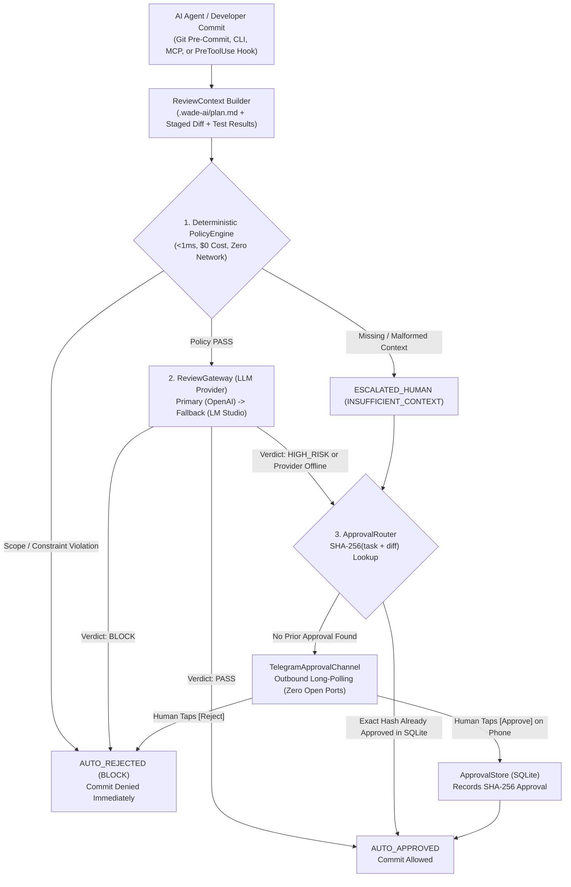

# wade-ai

Reusable, project-independent AI engineering & zero-trust code-review gateway.

## Overview

`wade-ai` provides a deterministic code-review gateway and human-in-the-loop (HITL) approval router designed to decouple AI-assisted review guardrails from specific software repositories and IDE agents.

### Core Principles
- **Bounded Context**: Reviews operate on explicit, self-contained payloads (`task`, `authorized_files`, `diff`, `test_results`, `constraints`).
- **Deterministic Gatekeeper (Short-Circuit Evaluation)**: Non-overridable policy engine enforces file-scope bounds, path-traversal guards, test status, and hard constraints in `<1ms` before any LLM invocation (mitigating **OWASP LLM07:2025 System Prompt Leakage**).
- **Cryptographic TOCTOU Protection**: Human approvals via Telegram are bound to a `SHA-256(task + normalized_diff)` checksum in SQLite, preventing **OWASP LLM06:2025 Excessive Agency** and Time-of-Check to Time-of-Use race conditions.
- **Multi-Surface Integration**: Works natively as a CLI (`wade-ai review`), Git `pre-commit` hook, Antigravity `PreToolUse` hook, and **Model Context Protocol (MCP)** `JSON-RPC 2.0` server over `stdio`.

---

## Architecture Diagram



---

## Quick Start

```bash
# 1. Validate project plan (.wade-ai/plan.md)
wade-ai check-plan

# 2. Review currently staged git changes with Telegram escalation
wade-ai review --staged --notify

# 3. Poll Telegram for human [Approve] / [Reject] button callbacks
wade-ai poll-approvals --once

# 4. Run the full 192-test verification suite
pytest -v
```
